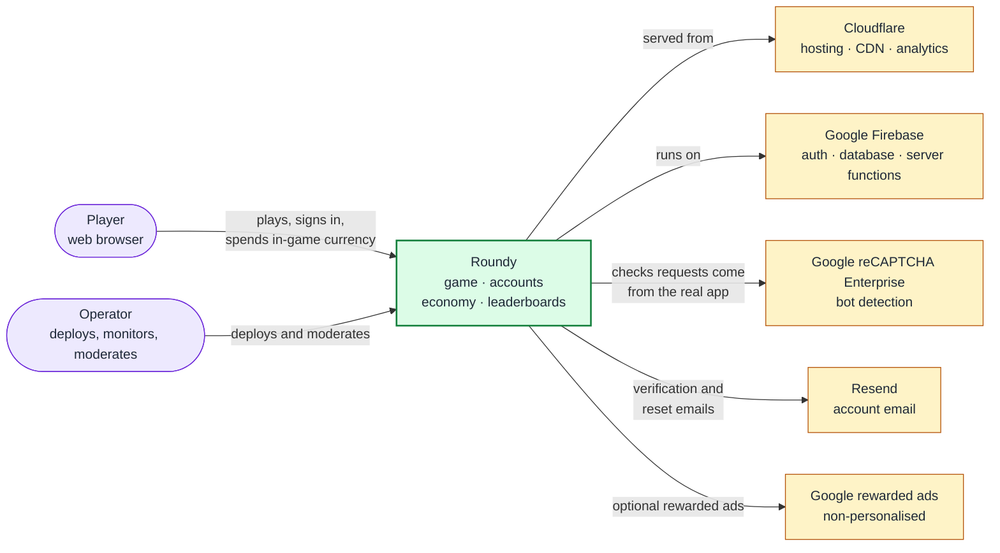
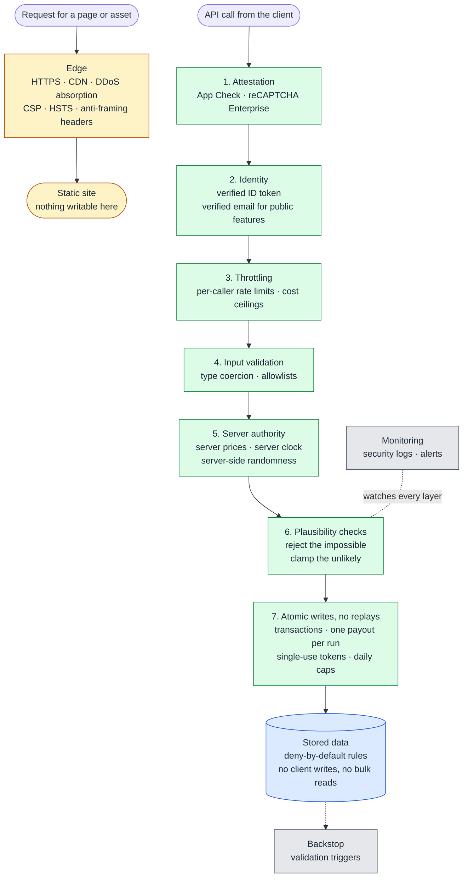
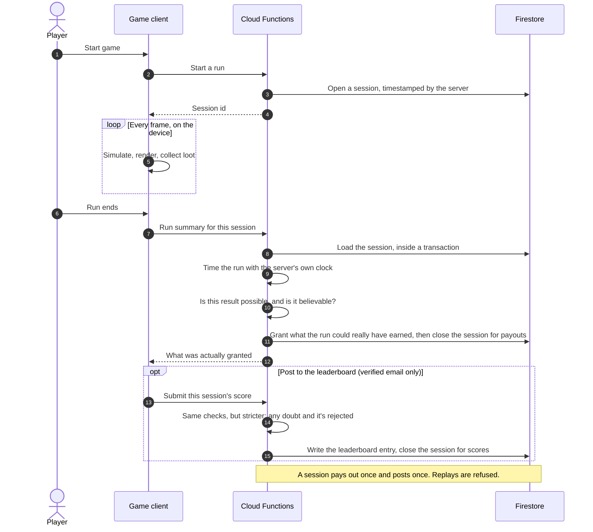
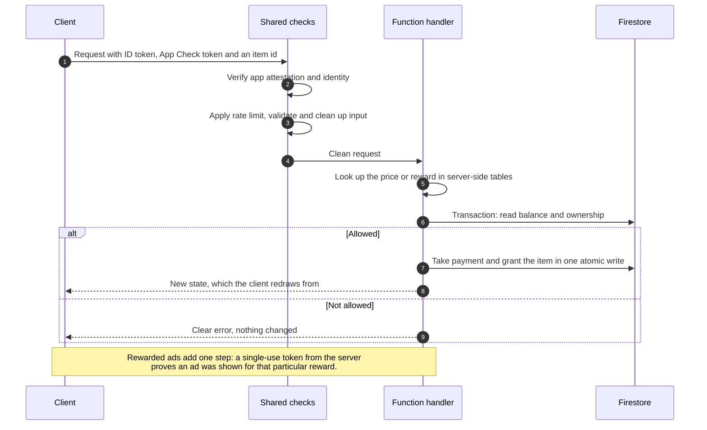
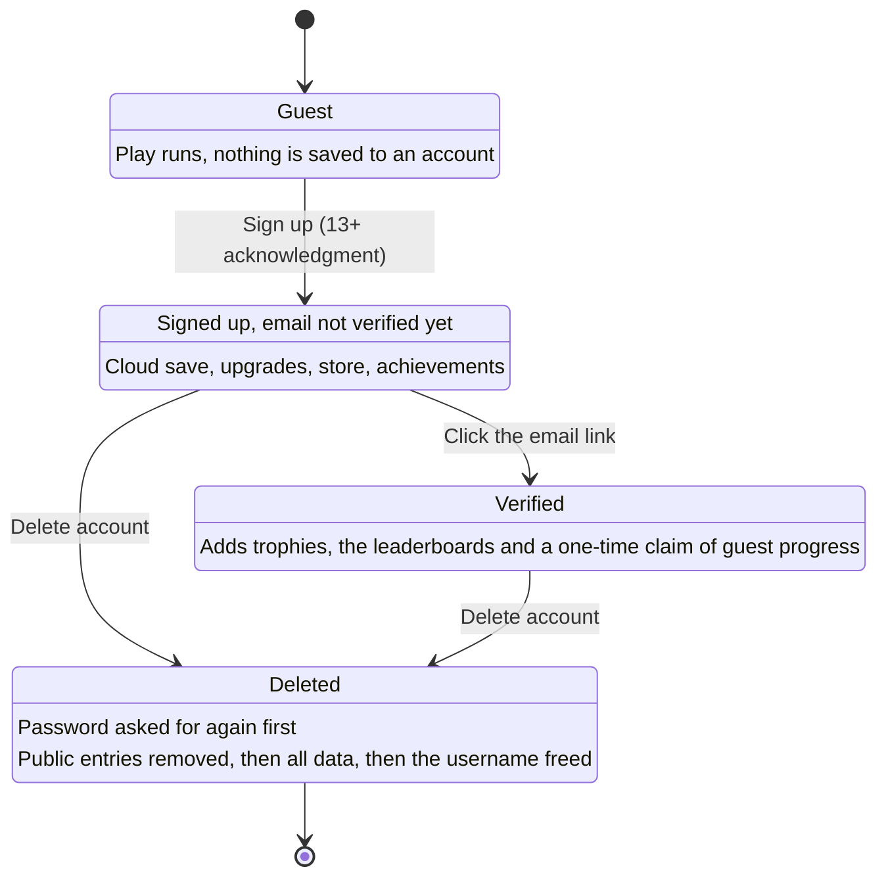
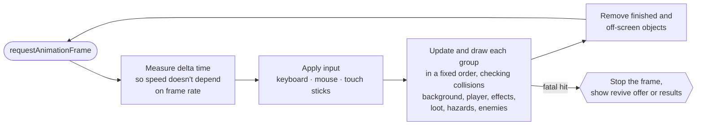
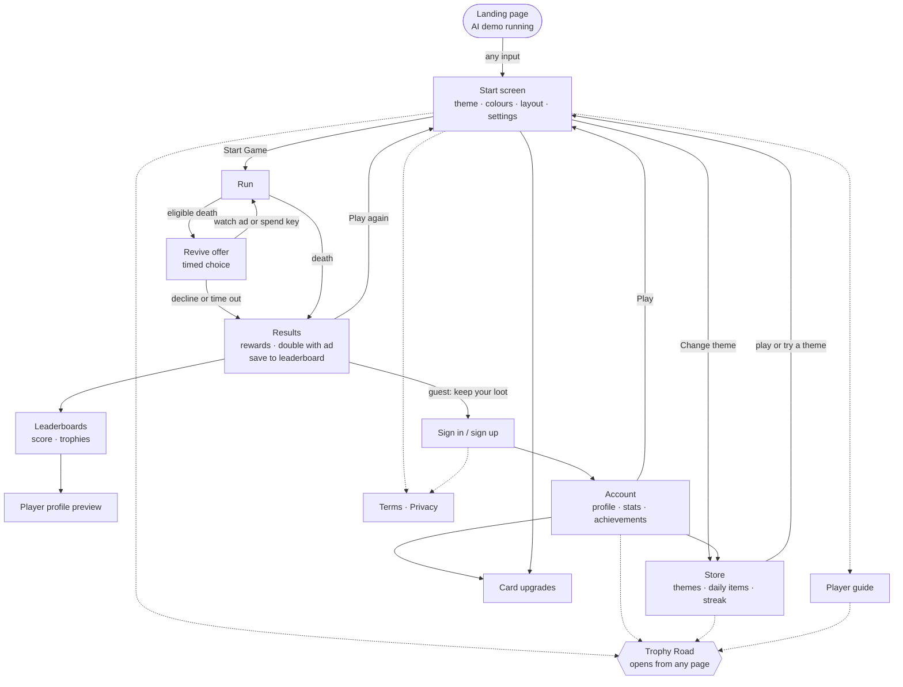

<div align="center">

# Roundy

An endless arcade shooter for the browser, with eight themes that each change the rules.

**[Play at playroundy.com](https://playroundy.com)**

[Player guide](https://playroundy.com/help.html) · [Terms of Service](https://playroundy.com/terms.html) · [Privacy Policy](https://playroundy.com/privacy.html)

</div>

---

## Contents

1. [About this repository](#about-this-repository)
2. [The game](#the-game)
3. [Architecture](#architecture)
4. [Repository layout](#repository-layout)
5. [Security](#security)
6. [Accounts and settings](#accounts-and-settings)
7. [Services and tech stack](#services-and-tech-stack)
8. [Copyright](#copyright)

---

## About this repository

Roundy is a game I designed, built and operate independently. Its source code is held in a private repository. This repository documents the system's architecture and security model: how requests travel from a player's device to the database, where the trust boundaries sit, and which controls protect each step.

All diagrams are written in Mermaid and rendered by GitHub, which provides zoom, pan and full-screen controls on each one.

---

## The game

The player pilots a ship at the centre of the screen while enemies approach from every edge, growing faster and more numerous as the score rises. Contact with an enemy ends the run unless a shield is active. Most mechanics unlock at score milestones, so each run escalates the longer it lasts.

### Gameplay

| | |
|---|---|
| **Abilities** | Laser (a piercing beam), Blast (a close-range shockwave), Wave (an expanding ring that pushes enemies back) and Snap (vertical lines that clear everything they cross). Charges are earned at score milestones during a run. |
| **Power-ups** | Shield and Triple Shot appear as pickups on the field. Projectile is a permanent upgrade to the standard shot. |
| **Loot** | Enemies drop coins, upgrade cards, occasional diamonds and, rarely, keys. |
| **Upgrades** | Cards and coins purchase permanent levels: up to level 8 for abilities and level 4 for power-ups. Diamonds can cover a card shortfall once a player is at least halfway to the next level. |
| **Revives** | An eligible death offers the option to continue. The first revive costs a short ad and the next two cost a key each. |
| **Trophies** | Saved runs earn trophies for verified accounts. The lifetime total places the player on one of ten badges along the Trophy Road, from Wooden to Champion. |
| **Leaderboards** | One for the best single runs and one for lifetime trophies. |
| **Achievements** | 34 one-time goals covering kills, games played, best score, time played, themes owned and login streak. |
| **Daily** | Free daily items, a 7-day login streak and a limited number of optional ad rewards. |

### Themes

Each theme changes the gameplay as well as the visuals.

| Theme | Mechanics |
|---|---|
| Normal | Geometric enemies with motion trails. The baseline that every other theme is balanced against. Free. |
| Emoji | Emoji enemies under the standard rules. The lowest-priced theme. |
| Fruit Salad | The fastest theme. Fruit slices in half, and shooting rotten fruit costs points, which rewards accuracy over volume. |
| Sports Arena | Goals, hoops and golf holes appear on the field. Sending a ball into a target earns a bonus, while a miss costs points. |
| Pool | Six pockets that end the run on contact. The player is assigned solids or stripes, and pocketing the wrong group or the 8-ball costs points. |
| Snow Crystal | Crystals merge into clusters and then into snowballs that absorb nearby enemies, so large ones have to be broken apart. |
| Solar System | Planets, fast asteroids and black holes that grow as they absorb enemies. Contact with a black hole ends the run. |
| Space Ships | The only theme in which enemies return fire. Enemy projectiles can be shot down. |

Themes can be trialled for a single session by watching an ad before being bought with coins.

Rather than opening on a static menu, the landing page runs the real game engine with an AI pilot cycling through the themes. Saving and rewards are disabled in this mode, so visitors see actual gameplay before starting a run.

---

## Architecture

The system is documented at several levels of detail, following the [C4 model](https://c4model.com): a context diagram for the overall picture, a container diagram for the deployable parts, and focused diagrams for individual flows. The account lifecycle uses a UML state diagram and the two request flows use sequence diagrams.

The colour scheme is consistent across all diagrams: red marks code running on the player's device, which is untrusted; green marks trusted server code; blue marks stored data; and yellow marks infrastructure and third-party services.

### 1. System context

Roundy as a single system, with the people and external services it depends on.



### 2. Containers and trust boundaries

The primary diagram. It expands the Roundy system into its deployable parts. The two dashed borders are trust boundaries: anything originating on the player's device is treated as an unverified claim until the server has validated it. The diagram reads left to right, in the order a request travels.

```mermaid
flowchart LR
    accTitle: Roundy containers and trust boundaries
    accDescr: Player devices load the client from Cloudflare. The client is untrusted and can only change data by calling Cloud Functions, which verify app attestation and identity before validating every request and writing to Firestore in transactions. Firestore rules refuse all direct client writes. Validation triggers act as a backstop. Email goes through Resend and ads through Google.

    subgraph PLAYERS["Player device"]
        BROWSER["Web browser<br/>desktop · phone · tablet"]
    end

    subgraph EDGE["Cloudflare (static files only)"]
        CDN["Cloudflare Pages<br/>global CDN · DDoS absorption<br/>security headers"]
    end

    subgraph DEVICE["Client app: runs on the player's device, untrusted"]
        PAGES["Pages<br/>game · sign-in · account<br/>store · guide · legal"]
        ENGINE["Game engine<br/>HTML Canvas 2D<br/>simulation and rendering"]
        CSVC["Client services<br/>session · ads · email flows<br/>display copies of game rules"]
    end

    subgraph TRUSTED["Google Cloud / Firebase: trusted"]
        direction TB
        ATTEST["App Check<br/>+ reCAPTCHA Enterprise<br/><i>is this the real app?</i>"]
        AUTH["Firebase Auth<br/><i>who is this player?</i>"]

        subgraph API["Cloud Functions: the only code that writes data"]
            direction TB
            GUARD["Shared checks<br/>attestation · identity<br/>rate limits · input validation"]
            GAMEPLAY["Gameplay<br/>runs · results · leaderboards"]
            ECONOMY["Economy<br/>upgrades · store · daily rewards"]
            REWARDS["Rewarded ads<br/>token-gated payouts"]
            ACCOUNTS["Accounts<br/>profiles · usernames · deletion"]
            EMAIL["Account email<br/>verification · password reset"]
        end

        subgraph DB["Cloud Firestore: rules block every client write"]
            direction TB
            PUBLIC[("Public data<br/>profiles · leaderboards")]
            PRIVATE[("Private player data<br/>only its owner can read it")]
            SYSTEM[("System data<br/>server only")]
        end

        TRIGGERS["Validation triggers<br/>catch bad data"]
    end

    subgraph THIRD["Third parties"]
        RESEND["Resend<br/>transactional email"]
        ADNET["Google rewarded ads"]
    end

    BROWSER -->|"HTTPS"| CDN
    CDN -->|"HTML · JS · art"| PAGES
    PAGES --> ENGINE
    ENGINE -->|"run summary"| CSVC

    CSVC -->|"sign in"| AUTH
    CSVC -->|"device attestation"| ATTEST
    CSVC ==>|"API calls with identity<br/>and attestation tokens,<br/>IDs and summaries, never amounts"| GUARD
    ATTEST -.->|"token checked"| GUARD
    AUTH -.->|"identity checked"| GUARD

    GUARD --> GAMEPLAY
    GUARD --> ECONOMY
    GUARD --> REWARDS
    GUARD --> ACCOUNTS
    GUARD --> EMAIL

    GAMEPLAY ==>|"transactions"| PUBLIC
    GAMEPLAY ==> PRIVATE
    ECONOMY ==> PRIVATE
    REWARDS ==> PRIVATE
    ACCOUNTS ==> PUBLIC
    ACCOUNTS ==> PRIVATE
    ACCOUNTS ==> SYSTEM
    GUARD ==>|"counters"| SYSTEM

    CSVC -.->|"read only:<br/>own data, public data"| PRIVATE
    CSVC --x|"direct writes<br/>blocked"| DB
    DB -.->|"on change"| TRIGGERS

    EMAIL --> RESEND
    CSVC -->|"show ad"| ADNET

    classDef untrusted fill:#fee2e2,stroke:#b91c1c,color:#1f2937
    classDef trusted fill:#dcfce7,stroke:#15803d,color:#1f2937
    classDef gate fill:#86efac,stroke:#14532d,stroke-width:3px,color:#052e16
    classDef data fill:#dbeafe,stroke:#1d4ed8,color:#1f2937
    classDef infra fill:#fef3c7,stroke:#b45309,color:#1f2937

    class BROWSER,PAGES,ENGINE,CSVC untrusted
    class GAMEPLAY,ECONOMY,REWARDS,ACCOUNTS,EMAIL,TRIGGERS,AUTH trusted
    class GUARD,ATTEST gate
    class PUBLIC,PRIVATE,SYSTEM data
    class CDN,RESEND,ADNET infra

    style PLAYERS stroke:#b91c1c,stroke-width:1px
    style DEVICE stroke:#b91c1c,stroke-width:3px,stroke-dasharray:8 5
    style TRUSTED stroke:#15803d,stroke-width:3px,stroke-dasharray:8 5
```



The thick arrows are the only path by which data changes. The client may read its own private data and public data directly, which keeps reads fast, but it has no write access. Every change is a request to a Cloud Function, which validates it and writes inside a transaction.

**Deployment.** Pushing to the private repository triggers a Cloudflare Pages build with Vite, which publishes the static site to Cloudflare's network. The backend, database rules and indexes are deployed separately with the Firebase CLI. Where client and server must agree on a value, the client is deployed first, so a newer server never penalises a player still running the previous version.

### 3. Defence in depth

The layers a request must pass before it can change stored data. Static files and API calls take separate paths and are protected separately. Each layer is designed on the assumption that the one before it may fail.



### 4. Life of a run

Because the game runs on the player's device, everything the client reports could have been tampered with. The server therefore opens each run itself, measures its duration with its own clock, checks the result against what the game can actually produce in that time, and pays out at most once per run.



The two outcomes are handled differently by design. For in-game currency and cards, suspicious values are clamped to what the server can justify, so a legitimate player affected by an unusual edge case keeps the run. For the leaderboard, doubtful results are rejected outright, because a public ranking is where a fabricated result harms other players. Accounts that repeatedly submit suspicious runs lose leaderboard access but can continue to play.

### 5. Server-authoritative requests

Every purchase, claim and reward follows the same pattern: the client requests and the server decides. The client sends only an identifier, never a price or an amount. The "shared checks" are not a separate service; they are the common checks every function performs before any other work.



### 6. Account lifecycle



Email verification is required only for the features most attractive to throwaway-account farming: trophies, the leaderboards and the one-time transfer of guest progress. All other features are available immediately after sign-up.

### 7. Game loop

A single frame of the engine, which is written in plain JavaScript on an HTML canvas without a game framework.



Further engine details:

- Phones, tablets and desktops each receive their own scale and speed settings. Tablets are identified by device capabilities rather than user-agent, which also covers iPads that identify themselves as Macs.
- The canvas renders at the device's native pixel density, and a particle budget keeps frame rates stable on phones during busy scenes.
- The landing demo and selected decorative animations are disabled when the system requests reduced motion. Ability keys are fully rebindable, and touch controls offer a left-handed layout.

### 8. Navigation



### Design principles

1. **The client is never trusted.** The player's device renders the game and reports outcomes. It never determines prices, payouts or rankings.
2. **There is a single write path.** Every change goes through a server function that validates it and writes in a transaction. Database rules block all other writes.
3. **Each path has independent protection.** Static files are protected at Cloudflare's edge. The API is protected by app attestation, authentication, rate limits and cost ceilings. Neither depends on the other.
4. **The server owns time, prices and randomness.** Run durations, item prices and daily shop contents are all determined server-side.
5. **Failures are handled safely, with a backstop.** Legitimate edge cases are clamped rather than penalised, triggers catch any invalid data that bypasses the normal path, and every security decision is logged.

---

## Repository layout

The private repository separates server and client code into distinct top-level folders, so the trust boundary is reflected in the file structure.

```text
Cosmic-Rush-Project/
├── firestore.rules              Database access rules, deny by default
├── firebase.json                Backend project configuration
├── firestore.indexes.json       Index configuration (unused indexes disabled)
│
├── functions/                   SERVER, trusted (Cloud Functions, Node 22)
│   └── index.js                 API endpoints, shared checks, validation
│
└── cosmic-rush-vite/            CLIENT, untrusted (Vite multi-page app)
    ├── index.html               Game
    ├── auth.html · account.html · theme.html · help.html
    ├── privacy.html · terms.html · 404.html
    ├── public/                  Static files served as-is, including security headers
    └── src/
        ├── roundy.js            Game engine
        ├── *.js                 Page logic and shared client modules
        └── (asset folders)      Sprites, audio, video and theme artwork
```

| Responsibility | Location |
|---|---|
| Data access policy | `firestore.rules` |
| Data changes and validation | `functions/` |
| Security headers and CSP | `cosmic-rush-vite/public/` |
| Game simulation and rendering | `cosmic-rush-vite/src/roundy.js` |
| User interface | `cosmic-rush-vite/*.html` and `src/` |

---

## Security

Every control below is active in production. Controls are described by what they protect rather than by their specific configuration.

### Server authority

- The client has no write access to the database. Rules deny every direct write to every collection, and the client code contains no write operations.
- Bulk reads are blocked. Public data can only be fetched one document at a time, and the leaderboards are served by cached server functions rather than open queries, which prevents scraping.
- Every API function enforces App Check, so requests must originate from the genuine app. Functions that handle player data also require authentication. The small number of functions available to signed-out visitors (leaderboards, username availability and password reset) are rate limited separately.
- Every API function is rate limited per player or per network address, using server-side counters that persist across restarts and are shared across instances.
- Hard limits on server capacity and execution time cap the cost of a runaway bug or a traffic flood.
- Prices, rewards and exchange rates exist only on the server. The client sends item identifiers, never amounts.
- The daily shop is generated server-side from the date, and the login streak runs on server UTC time, so altering a device's clock or time zone has no effect.
- Achievements are re-verified against the server's own records at claim time.
- Every purchase and claim is a single transaction that verifies ownership before balance, preventing double charges.

### Cheat prevention

- The server owns the clock. It opens and timestamps each run itself and derives the duration from that timestamp rather than from client input.
- Results are checked against what the game can actually produce in the elapsed time, and physically impossible results are rejected.
- Strictness scales with the stakes. The leaderboard rejects anything doubtful, while the in-game economy clamps suspicious values instead, so legitimate players never lose a whole run to an edge case.
- Replays are prevented. A run pays out once, posts a score once and can be doubled once, and tokens are single-use.
- Accounts that repeatedly submit suspicious runs are removed from the leaderboards while remaining able to play. Removals can be reversed on appeal.
- Failed checks return a generic error, and the specific reason is recorded only in server logs.
- Malformed numeric input such as `NaN`, `Infinity` and negative values is neutralised on arrival, before any validation runs.
- Data stored on the device is never trusted. Progress saved locally for a later retry is re-validated by the server like any other request.

### Ads and rewards

- Ad rewards require a single-use, server-issued token bound to one specific reward, so it cannot be redeemed for a different reward or reused.
- Every ad reward has a daily cap, and the store checks the remaining allowance before showing an ad, so players never watch an ad that cannot pay out.
- Reward doubling re-applies the server's original grant rather than any value supplied by the client.
- Ads are non-personalised for all players, consistent with the general-audience [Terms of Service](https://playroundy.com/terms.html).

### Accounts

- Email verification is required only for trophies, the leaderboards and the one-time guest progress transfer. All other features are available immediately after sign-up.
- Usernames are unique regardless of capitalisation and are claimed atomically, so two accounts cannot claim the same name at once, and no account can release another account's name.
- Profanity filtering detects character substitutions and padding, applies the same logic on client and server, and avoids false positives on legitimate names.
- User-supplied values are validated against allowlists before being stored or displayed publicly.
- Database triggers detect invalid data arriving by any route, such as a manual console edit, and revert it safely.
- Sign-ups are rate limited per network as well as per account, since automated scripts can create a new account for each attempt.
- Account deletion requires re-entering the password and removes everything in order: public leaderboard entries first, then all player data, then the username reservation.
- Password reset is designed not to reveal whether an account exists for a given email address.
- Sign-up requires confirmation that the user is 13 or older. Guest play remains open to everyone.

### Email

- Emails are rate limited per user and per destination address to prevent inbox flooding. Verified accounts cannot trigger further verification emails.
- Each email type has its own sending budget, so a surge in password-reset requests cannot exhaust the budget reserved for new players' verification emails. A fallback sender covers outages of the primary provider.
- Email addresses are never written to logs in plain text.

### Browser

- A strict Content Security Policy with no inline scripts or inline event handlers anywhere. Framing is blocked with `frame-ancestors 'none'`, and object, base-URI and form-action sources are restricted.
- HSTS, `X-Frame-Options: DENY`, `nosniff`, a strict `Referrer-Policy`, and a `Permissions-Policy` that disables camera, microphone and location access.
- Player names and bios are always rendered as text, never as HTML, preventing stored XSS.
- The reCAPTCHA Enterprise key used by App Check is restricted to the production domain.
- Production builds ship without source maps.
- Security headers are tested locally against the production build before each deployment.

### Abuse and cost resilience

- The static site is served from Cloudflare's network, which absorbs large-scale traffic floods.
- The API has independent protection that does not rely on Cloudflare: attestation, authentication, per-caller limits that cannot be bypassed by spoofing request headers, cached public endpoints and hard cost ceilings.
- Rate-limit records carry an expiry date, allowing them to be cleaned up automatically rather than accumulating indefinitely.

### Privacy

- Analytics are cookieless and count visits in aggregate only.
- Players in the EEA, UK and Switzerland are shown a certified consent dialog.
- Photo uploads are not supported; avatars are chosen from a preset collection.
- Players can edit their profile, delete individual scores or delete their entire account themselves.
- Full details are available in the [Privacy Policy](https://playroundy.com/privacy.html).

### Operations

- Security events are logged in a structured, searchable format, with expected rejections kept separate from genuine errors.
- Values shared between client and server are documented in both codebases, together with the required deployment order.
- The site is deployed to a single hosting target, so no outdated copy can remain live.

---

## Accounts and settings

### Account benefits

The game can be played without an account, but guest progress does not persist between visits. An account provides:

| | |
|---|---|
| **Cloud save** | Coins, cards, levels and themes are stored and available across devices. |
| **Upgrades, store and revives** | Card upgrades, theme purchases, daily items and key revives require an account. |
| **Trophies and leaderboards** | Lifetime trophies and best runs ranked against all players (requires a verified email). |
| **Achievements** | 34 goals with rewards, tracked automatically. |
| **Daily streak** | A 7-day reward cycle for consecutive logins. |
| **Guest progress transfer** | Loot from a guest run can be claimed once after sign-up and email verification. |

### Profile

- **Username:** 1 to 15 letters, numbers or underscores, unique regardless of capitalisation. Public.
- **Bio:** short and public.
- **Avatar:** chosen from a preset collection. Uploads are not supported, so no personal images are hosted.
- **Lifetime stats:** best score, games played, enemies defeated, time played, best streak and themes owned.
- **High scores:** the player's top runs. Any entry can be deleted, which also removes its leaderboard entry.

### Account settings

- **Change password:** via a reset link sent to the account's email address.
- **Delete account:** requires the password, then removes the login and all stored data, including leaderboard entries.
- **Verification banner:** shown in amber rather than red, as it indicates pending optional features rather than an error.

### Game settings

| Setting | Function | Purpose |
|---|---|---|
| Movement style | WASD or arrow keys | Comfort across keyboard layouts. |
| Key bindings | Rebind Blast, Wave, Snap and Laser to any letter key (except movement keys) or the right mouse button | Accessibility and personal preference. |
| Reset to default | Restores all bindings | Quick recovery after customisation. |
| Ship & Blast colour | Colour picker | Personalisation and visibility against each theme. |
| Projectile colour | Colour picker | Distinguishes the player's shots from enemy fire. |
| Layout | Right-handed or left-handed | Mirrors both touch sticks for left-handed players. |
| Mute | Sound on or off, remembered between visits | Silent play. |
| Theme | Any owned theme, or a trial unlocked by an ad | Each theme plays differently. |
| Reduced motion | Follows the system setting | Disables the landing demo and selected decorative animations. |

### Controls

| Desktop | Touch |
|---|---|
| Move with WASD or the arrow keys | Left stick to move |
| Aim with the mouse | Right stick to aim and fire, or tap to shoot in the current direction |
| Left click to shoot | Ability buttons arranged around the fire stick |
| Laser on right click, Blast on E, Wave on R, Snap on F | Left-handed layout mirrors both sticks |

---

## Services and tech stack

| Service | Purpose | Notes |
|---|---|---|
| Cloudflare Pages | Hosting and CDN | Builds from the private GitHub repository, serves the security headers and absorbs traffic floods. |
| Cloudflare Web Analytics | Visit statistics | Cookieless, with no device storage or fingerprinting. |
| Cloudflare Email Routing | Support inbox | Forwards mail sent to the support address. |
| Firebase Authentication | Accounts | Email and password. Verification unlocks the public features. |
| Cloud Firestore | Game data | US multi-region. All client writes blocked. |
| Cloud Functions for Firebase (v2) | All game logic that modifies data | Node 22, with App Check enforced on every function. |
| Firebase App Check | Request attestation | Backed by reCAPTCHA Enterprise. |
| Google reCAPTCHA Enterprise | Bot detection for App Check | Key restricted to the production domain. |
| Google Cloud Logging and Billing | Observability and cost control | Security logs, alerts and budget alerts. |
| Resend | Verification and password-reset email | Firebase's built-in email templates serve as the fallback. No marketing email is sent. |
| Google Ad Placement API (AdSense H5 Games) | Optional rewarded video ads | Non-personalised for all players. |
| Google Funding Choices | Consent management for the EEA, UK and Switzerland | Google-certified consent platform. |
| Google Fonts | Typography (Poppins) | |
| GitHub | Private source repository | Pushes trigger a Cloudflare Pages build. |

| Technology | Role |
|---|---|
| JavaScript and HTML Canvas 2D | Game engine, without a game framework |
| Vite 7 | Multi-page build with content-hashed assets |
| Firebase JS SDK 12 | Client-side Auth, Firestore reads, Functions and App Check |
| firebase-admin / firebase-functions | Server runtime |

---

## Copyright

Roundy is live at [playroundy.com](https://playroundy.com). Use of the game is governed by the [Terms of Service](https://playroundy.com/terms.html) and the [Privacy Policy](https://playroundy.com/privacy.html).

Copyright © 2026 Roundy. All rights reserved.

This repository documents a proprietary game. The game, including its source code, artwork, characters, themes, names, logos, sounds and design, may not be copied, reproduced, distributed, reverse-engineered or used to create derivative works without prior written permission. See [LICENSE](LICENSE).

Contact: support@playroundy.com
